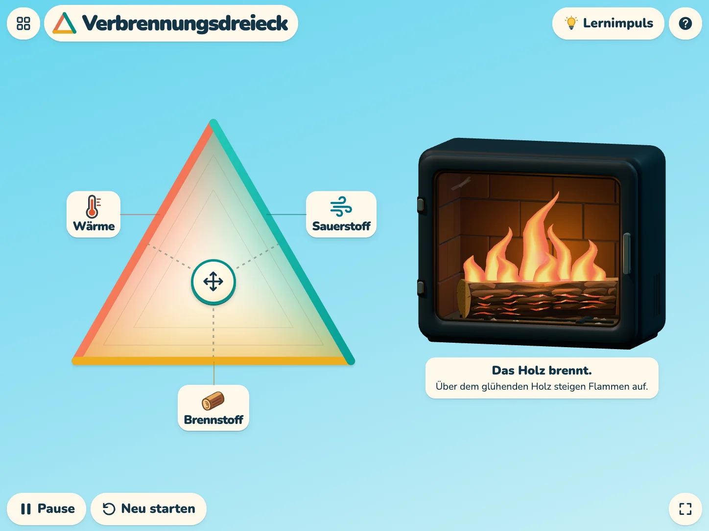
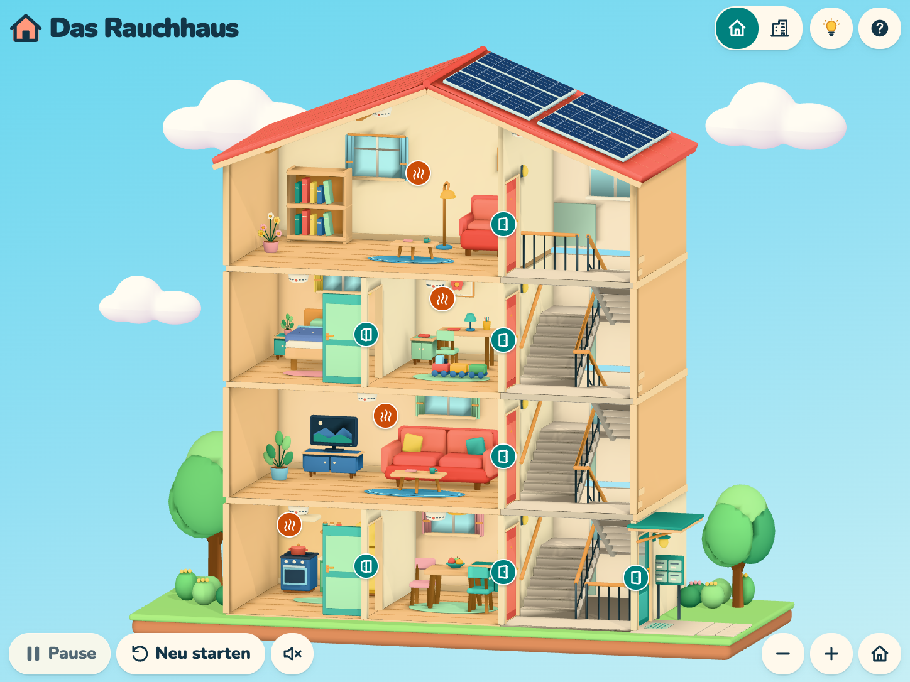
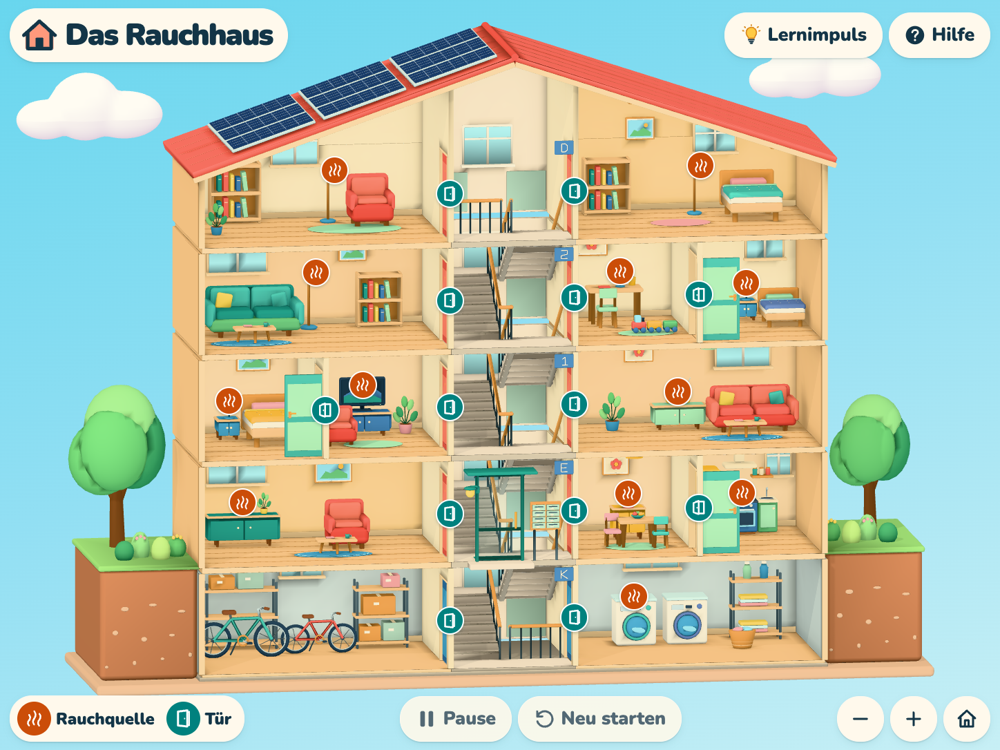

# Brandschutzfrüherziehung

[Open the published version from main](https://daslukas.github.io/rauchhaus/)

Two German, touch-first fire science activities for primary-school children aged 6–10. The home page opens a lesson picker with still previews from both scenes. Open **Brandhaus** to explore smoke and fire in a building or **Verbrennungsdreieck** to explore a wood fire. Each module has its own shareable URL, an optional guided activity and an **Übersicht** link back to the picker. The 3D activities need WebGL 2. The application runs locally in the browser after its assets have loaded.

## Verbrennungsdreieck

Open `?modul=verbrennungsdreieck`. Drag the knob or tap a point in the triangle. Moving farther from an edge reduces the corresponding condition. In the centre all three are sufficient. The thermometer stands for heat, the wind symbol for oxygen and the log for fuel. The adjacent stove shows the effect on wood, flame and glow. The stove starts at a slight angle so its front and right side are visible. Drag directly on the stove or focus it and use the left and right arrow keys to look around. Home restores its starting view. With the knob focused, arrow keys move it and Home centres it.

Choose **Lernimpuls** for three short trials. Each starts with the same burning log. Follow the arrow with the knob or press **Zeigen** to see what changes. With less oxygen the flames become smaller. Cooling puts out the flames and leaves the wood in place. In the fuel trial the log burns away from the top down until only a little ash remains. Press **Weiter** for the next trial. **Fertig** and the close button return to the original free experiment and viewing angle.



The stove uses an [editable animated Blender scene](assets/blender/holzofen.blend). To regenerate the source and its self-contained web model with Blender 5.3, run:

```sh
blender --background --python-exit-code 1 --python assets/blender/build_stove.py
npm run check:model
```

## Brandhaus

Open `?modul=brandhaus` for the small house. Existing links with `?haus=klein` or `?haus=gross` still open that house directly. Each level has one selectable fire source. Tap the orange marker beside the object to see a small local flame and a rising smoke plume. A check mark identifies the active source. Tapping it again keeps the current experiment and its pause state. Tap a turquoise marker to open a door. Observe the plume, the ceiling layer and the shared stairwell. Under **Lernimpuls**, choose **Wohin zieht der Rauch?** to compare the same television fire with the apartment door open and closed. Watch what changes in the stairwell.

Before starting a fire, tap a blue **i** to read a short safety tip beside its object. Close it or press Escape to continue at that spot. The small house covers the stove, the apartment door, the bedroom smoke alarm and the attic reading lamp. The large house covers the laundry door, the dining-room candle, a plant on the second-floor landing and calling 112 from a smoke-free room when smoke blocks the shared stairs. Starting a fire or a guided activity hides the tips, including during pauses. Resetting or leaving the activity brings them back.

In the small-house overview, the television and desk lamp can start a fire. Select the ground floor to try the stove or the attic to try the reading lamp. In the large-house overview, each floor shows the door from its fire apartment or laundry to the staircase. Tap a floor to see the other door controls there. With the house canvas focused, keys 1–4 select the ground floor through the attic, 0 selects the basement in the large house and Home restores the overview. All door controls in view are available during a free fire experiment.

A ceiling detector turns red when smoke reaches its sensor in the model. Active detectors share a flashing rhythm. Their positions, including those in kitchens and the stairwell, are observation points chosen for the lesson. The speaker button enables a shared alarm beep. Sound starts muted. **Neu starten** restores the initial doors and camera, ends any lesson and clears all smoke and alarms.

Pinch with two fingers on the house to zoom in or out. Use **Vollbild starten** to the right of the home button to present the entire workspace. Select **Vollbild beenden** to return. The control appears when the browser supports and permits page fullscreen. On iPads with Safari before 17.5, the house stays in the browser tab with its browser controls visible so both zoom gestures work.

In free exploration and in the door comparison, flames stay at the selected object. Smoke can reach other rooms and the stairwell. To explore how a room fire can develop beyond the original object, choose **Wie breitet sich Feuer aus?** under **Lernimpuls**. The class can observe the television fire together and discuss two frozen views of the room. Both stops fit into about 30–40 seconds of model playback, plus discussion time. **Beobachtung zeigen** advances to the first stop or plays the short upholstery transition into the second stop.



**Kleines Haus** is the default. Four apartments share a staircase on the right across the ground floor, two upper storeys and the attic. A glazed entrance through the right exterior wall leads directly onto the ground-floor landing. Its own door control opens the entrance.

Use **Großes Haus** above the scene to explore the larger building. Selecting a different house starts a fresh experiment in that house. The selected layout can be bookmarked with `?haus=klein` or `?haus=gross`.



The large house has eight apartments around one continuous staircase. Each full storey pairs a one-room home with a two-room home, alternating sides. A glazed entrance, mailboxes, handrails and half-landings mark the common circulation space. The basement contains a bicycle store and a shared laundry. Start the washing-machine experiment and try opening or closing the laundry door. Photovoltaic panels are visible on the roof.

For classroom handouts, the QR code links to **brandschutzfrüherziehung.de**. Download the [scalable SVG](public/rauchhaus-qr.svg) for print or the [PNG](public/rauchhaus-qr.png) for slides.

## Develop locally

Install Node.js 24.15 or later and npm. All three versioned GLB files are ready to serve. Blender is needed only when changing the artwork.

```sh
npm ci
npm run dev
```

Open the address printed by Vite. To view this branch on a tablet, serve the local development instance on a trusted network with `npm run dev -- --host 0.0.0.0`. To preview exactly what will be deployed, run `npm run build` followed by `npm run preview`.

## Verification

| Command | Verifies |
| --- | --- |
| `npm run lint` | Static analysis |
| `npm test` | Room filling, smoke balance, detectors, door changes, time-step invariance, fire development and guided activities, triangle geometry and navigation |
| `npm run check:model` | Editable Blender source and self-contained WebGL export, including house interaction anchors, moving doors, stove animation channels and mesh budgets |
| `npm run build` | TypeScript types and production bundle in `dist/` |
| `npm run check` | All four checks above |
| `npm run test:browser` | Compares rendered smoke and flame observations, runs the guided house and triangle activities, compares rendered stove states and camera views, and checks dashboard navigation and touch targets in installed Chrome. Run the build first. |

The browser test starts Chrome with its sandbox enabled and a new temporary profile, then closes the instance and removes the profile. It exercises the actual washing-machine control and detector in the app. A rendering fixture advances the television, laundry and desk-lamp experiments to repeatable observation points. The desk-lamp tests follow smoke through the attic door and, with that door closed, down to the lower landings. Set `RAUCHHAUS_TEST_URL` to test an existing deployment, or `RAUCHHAUS_SCREENSHOTS` to save evidence in a directory of your choice. Running the smoke source while reviewing a tablet in both orientations is part of release verification. On physical devices, check tap accuracy, swipe separation, frame rate and readability. A simulator is useful for Safari behavior and layout.

## Editing the house

Open the editable [small house](assets/blender/rauchhaus-klein.blend) or [large house](assets/blender/rauchhaus.blend) to inspect the furnished rooms, landscape, lighting, doors and anchors. The [Blender Python generator](assets/blender/build_house.py) builds the individual editable objects and the batched web version. Change the generator for reproducible artwork updates, then run the following from the project root with Blender 5.3 available.

```sh
# Small house
blender --background --python-exit-code 1 --python assets/blender/build_house.py -- --small
# Large house
blender --background --python-exit-code 1 --python assets/blender/build_house.py
npm run check:model
```

Before exporting, Blender checks each complete door and handle against nearby geometry at one-degree intervals. It also checks the stair treads, landings, headroom and open stairwell between floors. The generator replaces the selected house’s versioned `.blend` and `.glb` files. Save hand-modeled changes separately before regenerating. See the [architecture and model contract](ARCHITECTURE.md) for the shared layout and coordinates.

## Development and publishing

Use short-lived branches and pull requests against `main`. GitHub Actions installs the lockfile, runs the checks and tests the production website in Chrome. A successful run on `main` publishes the checked artifact to GitHub Pages. Choose **GitHub Actions** as the Pages source when deploying a fork. The static bundle supports project-relative URLs and can also be served from another static web host.

## Teaching basis

The dashboard’s **Fachquellen** dialog links each lesson to the relevant pages. The comparison below records the basis for the German text, the visual cues and their limits, reviewed on 23 November 2026.

| Where children encounter the claim | What the source supports and how the app uses it |
| --- | --- |
| Brandhaus help and door comparison | If your own apartment is on fire and the way out is clear, warn others, leave, pull the door shut if it is safe, stay outside and call 112. If smoke blocks the way out, stay on the smoke-free side of a closed door, call 112 and make yourself visible at a safe window. These instructions apply to the apartment building shown. [DFV/vfdb, cases 1 and 3, pp. 4–7 and 11–13](https://www.feuerwehrverband.de/app/uploads/2020/05/DFV_vfdb_Fachempfehlung_Verhalten_Brandfall_2019b.pdf#page=5) and [Provinzial, p. 6](https://www.provinzial.de/dam/jcr%3A3765eb23-daaa-4f56-93a9-95c5efa8982e/304001000190_0524_SP_KB_Brandschutzerziehung_Kinder.pdf#page=6). |
| Brandhaus doors and detector indicators | Smoke can still pass through gaps around a closed apartment door. The simulation compares how much smoke reaches the stairs at the same model time. Flashing red and the optional shared beep show local detector activation. Actual smoke alarms warn occupants to take action. [DFV/vfdb, p. 6](https://www.feuerwehrverband.de/app/uploads/2020/05/DFV_vfdb_Fachempfehlung_Verhalten_Brandfall_2019b.pdf#page=7) and [Provinzial, p. 7](https://www.provinzial.de/dam/jcr%3A3765eb23-daaa-4f56-93a9-95c5efa8982e/304001000190_0524_SP_KB_Brandschutzerziehung_Kinder.pdf#page=7). |
| Stove, candle and reading-lamp tips | Keep cloth away from the hob and hot lamps. An adult stays with a lit candle. Children who see damaged equipment leave it unused and tell an adult. [Provinzial, pp. 3 and 5](https://www.provinzial.de/dam/jcr%3A3765eb23-daaa-4f56-93a9-95c5efa8982e/304001000190_0524_SP_KB_Brandschutzerziehung_Kinder.pdf#page=3) and [VDE consumer guidance](https://www.vde.com/topics-de/verbraucherschutz/elektrogeraete-im-alltag). |
| Electrical appliances as a common cause | Among electrical fires investigated by the IFS in 2021, appliances accounted for 54% and building electrical installations for 25%. The separate 2016–2025 series attributes 30% of all investigated cases to the broader electricity category. The sample primarily covers substantial building damage. [IFS appliance breakdown, p. 5](https://www.schadenprisma.de/wp-content/uploads/pdf/2/sp_2_2023_art1.pdf#page=2) and [IFS 2016–2025 statistics](https://www.ifs-ev.org/wp-content/uploads/2026/04/ifs_brandursachenstatistik_2025.pdf). |
| Stair landing and laundry-door tips | Objects on a shared escape route can narrow it or add combustible material. The plant illustrates a trip hazard. An open basement door can let smoke spread up the staircase. [Frankfurt Fire Brigade](https://feuerwehr-frankfurt.de/ihre-sicherheit/brandschutz-zuhause) and [Sindelfingen Fire Brigade, p. 3](https://www.sindelfingen.de/fileadmin/Website/01_Sindelfingen/Dateien/Bauen__Wirtschaft__Verkehr/Bauen/Merkbl%C3%A4tter_Feuerwehr/2025-08_Merkblatt_Brandschutz_in_Mehrfamilienh%C3%A4usern_aktuell.pdf#page=3). |
| Bedroom smoke-alarm tip | Residential smoke-alarm requirements apply in every German state. They cover sleeping rooms and escape corridors within the dwelling. Some states include further rooms. An audible warning can wake a sleeping occupant. [State requirements](https://www.rauchmelder-lebensretter.de/rauchmelderpflicht/) and [Bavarian ministry guidance on rooms and shared stairs](https://www.bauministerium.bayern.de/assets/stmi/buw/baurechtundtechnik/rauchwarnmelderpflicht_fragen-und-antworten.pdf). |
| Brandhaus fire development | Flames can spread through combustible gases in the upper layer without other furnishings igniting. Flashover is the rapid transition to full room involvement. The lesson shows one possible sequence. The pale streaks over the seat are a visual cue for gases from heated upholstery. [NIST, flameover](https://www.nist.gov/glossary-term/24011) and [flashover](https://www.nist.gov/glossary-term/24071). |
| Verbrennungsdreieck controls | The primary-school triangle represents combustible material, oxygen and sufficient temperature. Here the log is already burning. Returning to the centre restores that starting comparison. [Alles über Feuer und Rauch, pp. 16 and 44](https://www.lfv-bayern.de/media/filer_public/04/70/04704151-06e7-42fe-8dca-6983a2219c21/alles-ueber-feuer-und-rauch-edition-bayern-2026-04-7.pdf#page=16). The [VdF NRW resource page](https://www.feuerwehrverband.nrw/verband/themen/brandschutzerziehung-und-brandschutzaufklaerung) also offers the teaching pack. |
| Flame, ember and ash observations | Wood can burn with flames, and char can glow after visible flames cease. Ash can retain hot embers. The control distances, glow brightness and cooling time are qualitative display settings. [USDA Wood Handbook, p. 17–6](https://research.fs.usda.gov/download/treesearch/7146.pdf#page=6), [Richter et al., particleboard experiments](https://ira.lib.polyu.edu.hk/handle/10397/92504) and [Bavarian environment ministry, hot ash](https://www.abfallratgeber.bayern.de/haushalte/abfallentsorgung/asche_heiss/index.htm). |

Each guided triangle trial asks a question and varies one condition while the other two remain sufficient. The teaching approach draws on studies of floating and sinking in third grade and of variable control at ages 7–10. These studies evaluated their own science tasks. [Hardy et al.](https://www.uni-muenster.de/imperia/md/content/didaktik_des_sachunterrichts/dokumente/literaturmoeller/article.pdf) and [Chen and Klahr](https://doi.org/10.1111/1467-8624.00081).

At the first stop in the fire lesson, pupils can look for brief tongues of flame along the lower edge of the smoke layer. At the second stop, flames are visible on furnishings away from the television. Heat radiated across the room can heat exposed, combustible surfaces until they ignite in rapid succession if sufficient oxygen is available. The clock sets the pace for classroom discussion. [New Zealand Fire Service training glossary, p. 159](https://www.fireandemergency.nz/assets/Documents/Files/Policy-Documents-part-2-QFC-1-07-Fire-Science-and-Ventilation-study-guide-Part-2.pdf#page=75), [Hessian State Fire Service School, sections 7.1 and 7.2](https://hlfs.hessen.de/sites/hlfs.hessen.de/files/2023-11/b-iii_lernu_einsatzlehre-explosion_01.00.00.pdf#page=16) and [NIST, Fire Dynamics](https://www.nist.gov/el/fire-research-division-73300/firegov-fire-service/fire-dynamics).

In the model, warm smoke rises to the ceiling. As the upper layer deepens, its lower edge reaches the top of an open door. Smoke then passes beneath the lintel, rises on the receiving side and spreads along the next ceiling. Closing the door reduces further transfer while smoke already in the room persists. The demonstration uses a light-to-dark grey palette to show increasing smoke loading. Its clock and colours are teaching choices. Real fire development, escape times and safe occupancy cannot be inferred from the animation.

To see a room fill, choose the desk lamp in the small house. Open the bedroom, landing and attic doors on the smoke path. The early plume is easy to follow. The teaching target is about 60% of the playroom volume occupied by the upper layer at 25 model seconds and about 80% at 40–45 seconds. The attic fills later. A source stays active throughout free exploration. Pause freezes the experiment. Only the active source marker stays visible. Use **Neu starten** to clear the experiment and choose another source. Each door-comparison trial pauses at 50 model seconds.

To follow smoke downstairs, repeat the desk-lamp experiment with its apartment door open and the attic apartment door closed. Watch the upper landings first. As smoke accumulates, the layer reaches the stair opening and spreads under the ceiling of the first-floor landing. The ground-floor landing follows later. The lower apartment doors can stay closed throughout.

In the large house, start the ground-floor kettle and open its apartment door. Smoke reaching the attic landing initially mixes with clear air and appears lighter than the smoke near the source. With a sustained supply, smoke continues to mix between occupied layers. Watch how the railing at the top gradually becomes harder to see.

- NIST describes the onset of doorway flow and the opposing lower air current in section 3.4.2 of its [CFAST model guide](https://nvlpubs.nist.gov/nistpubs/SpecialPublications/NIST.SP.1026r1.pdf).
- In full-scale apartment experiments, corridor visibility dropped sooner at 1.5 m above the floor than at 0.3 m after the apartment door opened. See figure 8 of [De Witte, Johansson and van Hees (2025)](https://doi.org/10.1177/07349041251377639).
- Experiments with an upstairs fire in a two-storey building showed that smoke can descend through vertical connections and that its distribution depends on ventilation. [Qi et al. (2024)](https://doi.org/10.1016/j.jobe.2024.111264).
- Full-scale stairwell experiments tracked light attenuation at each landing. With no upper outlet, the first smoke reaching the upper levels was dilute and the concentration there increased as smoke continued to enter. [Nii et al., figures 3 and 4](https://publications.iafss.org/publications/aofst/6/1b-1/view/aofst_6-1b-1.pdf).
- The renderer attenuates background light exponentially along a sightline, following the slice rendering approach in section 4.3.1 of the [NIST Smokeview technical reference](https://nvlpubs.nist.gov/nistpubs/SpecialPublications/NIST.SP.1017-2.pdf).
- In a full-scale house experiment, the open bedroom had higher peak temperature and carbon monoxide levels than the bedroom behind a closed door. The bedrooms were in a single-storey house. [FSRI, Before & After, table 1](https://fsri.org/program-update/close-you-doze-series-after).

## Licensing

Code and technical documentation use the [MIT License](LICENSE). Original 3D artwork, graphics and German educational content use [CC BY 4.0](public/licenses/CC-BY-4.0.txt). Suggested credit: “Brandschutz entdecken (formerly Das Rauchhaus), DasLukas and contributors,” with a link to this repository, a link to the license and a description of adaptations. The locally served Nunito font uses the [SIL Open Font License](public/licenses/Nunito-OFL.txt). Three.js uses the [MIT License](public/licenses/Three-MIT.txt).
